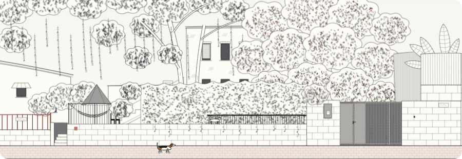

### 
Hi there! I'm Raz 🚀

  
  
  
  

  
  

  

#### About Me

I'm Raz, and I'm enthusiastic about all things software data and technology. I love to learn, explore, and collaborate on exciting projects. 

#### Toolbox

 
&nbsp;

#### Things I've built

- 🏠 **[house-drawing](https://github.com/raz-zeevy/house-drawing)**: an animated ink street in TypeScript and SVG with a real sunrise and sunset, wind you can steer, and a beagle and a white cat with routines of their own. [Go and click things.](https://raz-zeevy.github.io/house-drawing/)
- 📊 **[FSSA](https://github.com/raz-zeevy/fssa)**: a desktop app that lets researchers run Faceted Smallest Space Analysis without touching a command line. It ships with a Windows installer and [its own website](https://raz-zeevy.github.io/fssa/).
- 🧮 **[POSAC](https://github.com/raz-zeevy/posac)**: its sibling for Partial Order Scalogram Analysis, a Python GUI wrapped around a Fortran number-cruncher.
- ⛏️ **[perovskite-miner](https://github.com/raz-zeevy/perovskite-miner)**: an LLM pipeline that reads solar-cell papers and fills in about 70 database fields per paper, so researchers don't have to.
- 🗣️ **[Genlingo](https://github.com/raz-zeevy/Genlingo)**: feeds the human-language habit. It turns a word list into Anki flashcards with example sentences, pictures and audio.
- 🖼️ **[CLIP prefix caption](https://github.com/raz-zeevy/CLIP_prefix_caption)**: research in Prof. Omri Abend's NLP lab at HUJI. Can a captioning model describe word combinations it has never seen together?

#### Let's Connect

Feel free to connect with me on LinkedIn or drop me an email at raz3zeevy@gmail.com. Let's chat, collaborate, and learn together! 😄

 

<a href="https://raz-zeevy.github.io/house-drawing/">
  <picture>
    <source media="(prefers-color-scheme: dark)" srcset="assets/house-night.gif">
    
  </picture>
</a>

P.S. this is my street, drawn in js. <a href="https://raz-zeevy.github.io/house-drawing/">The live one</a> follows the real sunset, the wind follows your mouse, and the beagle does whatever he wants.

